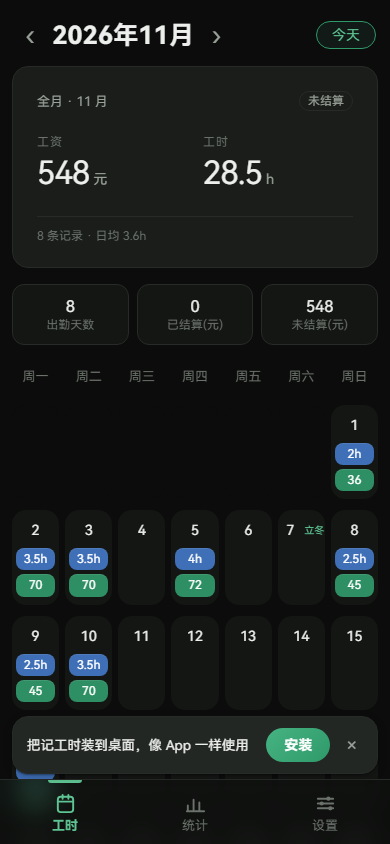
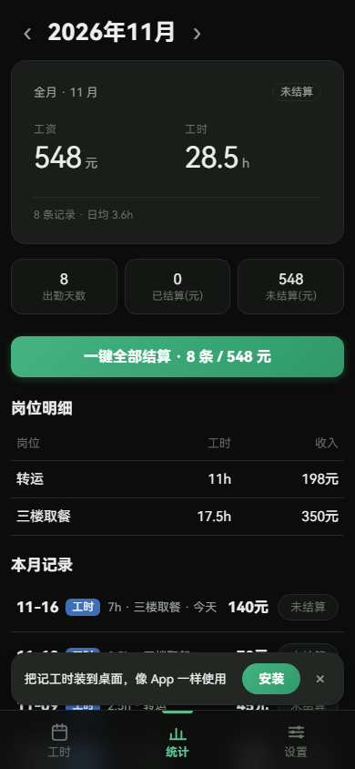

# 记工时

> 零广告的兼职记工时工具：按天记工时与收入、月历视图、统计对账、原生安装包，数据全部保存在本机。

[](https://jialueqian.github.io/work-hours-pwa/)
[](#android-安装包)
[](#ios-安装)

一套代码，三端使用：Android 原生安装包、iOS 主屏幕应用、任意浏览器网页版。零广告、零跳转、零服务器——所有数据只存在你自己的设备上。

| 月历打卡 | 统计对账 | 设置 |
|:---:|:---:|:---:|
|  |  |  |

## 为什么做它

市面上的记工时 App 广告极多、疯狂跳转，录一个半小时工时要拖半分钟滚轮。这个工具只做记工时这一件事：**录 0.5h 比点外卖还快，看完统计不用关弹窗，卸载前数据都在**。

## 功能特性

- **三种打卡类型**：工时（时长）、日结（固定金额）、时间（上下班时刻自动算时长，支持跨零点）
- **时长输入三通道**：常用档位一键点选（自动学习你的习惯）｜ ±0.5h 大按钮 ｜ 直接输数字——30 分钟不用划滚轮
- **连打**：打开新日期自动预填上次记录（岗位+时长），排班重复时一键确认；预填档位可在设置里自定义（最多 5 组）
- **多岗位多时薪**：时薪快照进每条记录，之后改价、删岗都不影响历史金额；也支持不设岗位的手动时薪
- **月历 + 翻转卡**：月汇总卡点一下翻面，直接看本月最忙的一周（工时/收入/出勤天数）
- **统计对账**：已结算/未结算金额、按岗位汇总、逐日明细一键结算
- **xlsx 导入导出**：Excel 表格查看备份，日结行自动跳过公式中和
- **自定义背景**：上传图片自动压缩，不透明度与截取方式可调，卡片半透明透出壁纸
- **离线可用**：Service Worker 缓存全部资源，断网照常打卡
- **零广告零跳转**：无任何第三方请求，界面只有你的数据

## 安装与使用

### Android 安装包

原生容器应用（应用页面整体打进 APK，**无网络权限**，系统级离线；覆盖更新不清数据，卸载才清）：

> 下载：https://wbapp-sgjijwhcuuezkmw5c6iiws.app.workbuddy.host/work-hours.apk?sharecode=74GWYB2SI6

### 网页版（PWA）

任意现代浏览器打开：**https://jialueqian.github.io/work-hours-pwa/**

- Android Chrome：菜单 →「安装应用」→ 桌面出现独立图标
- 国产浏览器（小米/华为/QQ/UC 等）：菜单 →「添加到主屏幕」

### iOS 安装

iOS 无法免费分发安装包，用 Safari 打开上方网页版链接 → 底部分享按钮（□↑）→ **「添加到主屏幕」**。装好即是全屏独立应用（含启动画面），数据独立于 Safari，离线可用。

> 注意：从微信打开请先点右上角 ··· 用系统浏览器/Safari 打开。

## 数据与隐私

- 所有数据保存在**设备本机**（浏览器 localStorage / 应用私有目录），不经过任何服务器
- 网页版换设备或清除浏览器数据前，用设置页的「导出备份(JSON)」迁移；也支持 Excel 备份
- 每条记录的时薪与金额在保存时快照，历史金额永不随岗位调整变化

## 技术栈

- 纯原生 HTML/CSS/JS（ES Modules），**零依赖、零构建、零外部请求**
- 数据层 localStorage（schema 版本化 + 全量 sanitize），离线 Service Worker（cache-first）
- 兼容基线 Chromium 69+：老语法已降级，`<dialog>` 有 polyfill，国产浏览器主流内核全覆盖
- Android：原生容器 APK（WebView + 本地 assets，aapt2/d8/apksigner 手动管线）
- iOS：PWA（apple-touch-icon / 启动画面 / standalone meta）

## 项目结构

```
├── index.html            入口
├── css/style.css         设计 token 化样式（深色主题）
├── js/
│   ├── store.js          数据层（唯一触碰 localStorage 的模块）
│   ├── calendar.js       月历视图
│   ├── dialog.js         打卡弹窗（三类型 + 三通道时长输入）
│   ├── cards.js          汇总卡与翻转卡
│   ├── stats.js          统计对账
│   ├── settings.js       岗位/外观/打卡设置/导入导出
│   ├── xlsx.js           Excel 导入导出
│   ├── install.js        安装能力检测与引导
│   ├── terms.js          节气表
│   └── app.js            入口与视图切换
├── sw.js                 Service Worker（离线缓存）
├── work-hours.apk        Android 原生安装包
├── .well-known/          Android TWA 域名校验
└── tools/                回归 / 部署验证 / CSS 契约检查脚本
```

## 开发与测试

```bash
# 本地预览（ES Modules 与 SW 需要 http）
python -m http.server 8080

# 数据层回归（30 项，覆盖时区/边界/恶意输入）
node tools/regression-round3.mjs

# 线上部署验证
node tools/verify-deploy.mjs
```

改任何静态资源后记得升 `sw.js` 的 `CACHE` 版本号。

## 许可

MIT
